# Lode Desk guide

Lode Desk is the desktop app for Lode. It shows a workspace's changes, history, locks, shelves,
branches and view, and runs the same operations as the `lode` command, so the two can be used
side by side on the same workspace. This guide follows a working day from installing the app
to merging a branch. Each part says what to click and what you should see.

The pictures are the light screens of `cargo run --example screenshots` in `desk/`,
with sample data (a depot called `game` on `lode.example.com`).

Contents: [Install](#install) · [Sign in](#sign-in) · [Check out](#check-out-a-depot) ·
[The daily loop](#the-daily-loop) · [Validation](#check-changes) · [History, blame and diffs](#history-blame-and-diffs) ·
[Shelves and review](#shelves-and-review) · [Branches and merges](#branches-and-merges) ·
[Conflicts](#conflicts) · [The workspace view](#the-workspace-view) · [Links](#links) ·
[Updates](#updates) · [Errors](#what-errors-mean)

## Install

Download the file for your system from the project's release page (tags `desk-v<version>`):

| System | File | Notes |
| --- | --- | --- |
| Windows 10 and 11 | `lode-desk-<version>-windows-x86_64-setup.exe`, or the `.msi` | The setup installs for you alone and needs no administrator; the MSI installs for everyone. |
| macOS 11 or newer | `lode-desk-<version>-macos-universal.dmg` | Open it and drag Lode Desk to Applications. |
| Debian, Ubuntu | `lode-desk-<version>-linux-x86_64.deb` | `sudo apt install ./lode-desk-….deb` |
| Any Linux | `lode-desk-<version>-linux-x86_64.AppImage` | Make it executable and run it. |

Until the project signs its installers, Windows may show "Windows protected your PC": choose
More info, then Run anyway. On macOS, right-click the app and choose Open the first time.

Every installer registers `lode://` links, so a link to a revision, file or shelf opens in the
app (see [Links](#links)). Lode Desk keeps its sign-ins in the same place as the `lode`
command: signing in with either one signs in both.

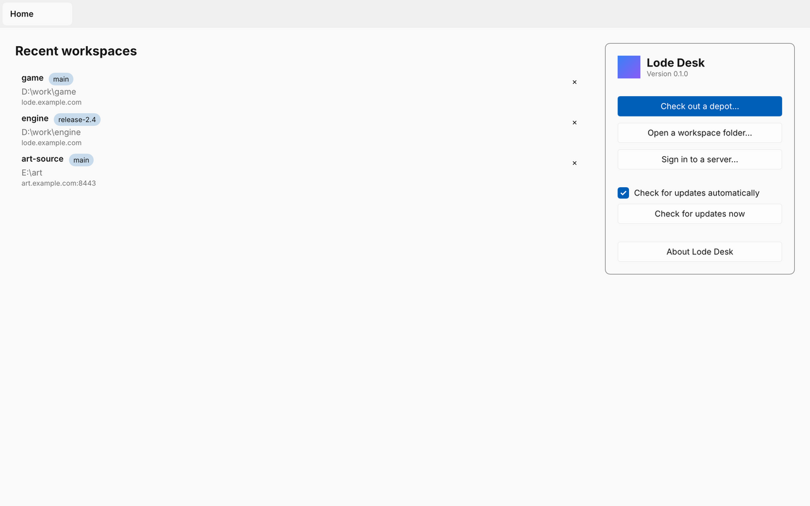

Home lists the workspaces you opened recently. The × beside one forgets it (the folder stays).

## Sign in

Home, **Sign in to a server…**. Give the server address (such as `https://lode.example.com`),
your name and your password. A wrong password says so and nothing is saved.

When the server offers single sign-on, a **Sign in with …** button appears once the address is
complete. It opens your browser at the company's sign-in page; finish there, and the dialog
says as whom you are signed in. If the browser does not open, the dialog shows the address to
open on this computer. Password sign-in may be for server administrators only; the dialog
says so.

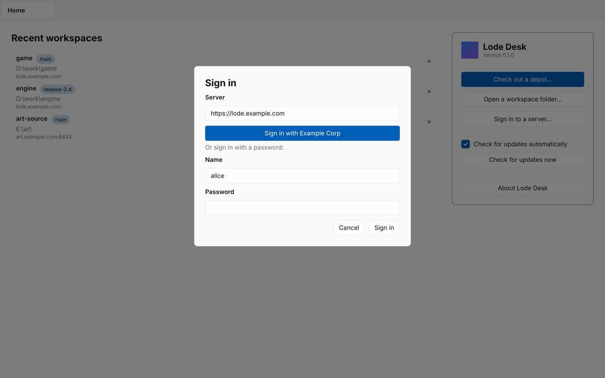

## Check out a depot

Home, **Check out a depot…**. The depot is the server address followed by the depot name, such
as `https://lode.example.com/skyfall`. Pick a branch (usually `main`) and an empty folder. The
progress shows the files arriving; then the workspace opens in a tab of its own.

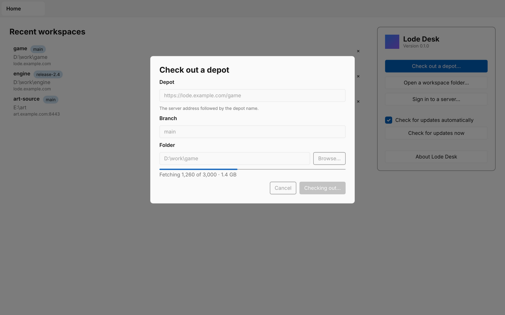

A workspace you already have opens from Home's list or with **Open a workspace folder…**. Each
open workspace has a tab; the sidebar shows its depot, server, branch and revision.

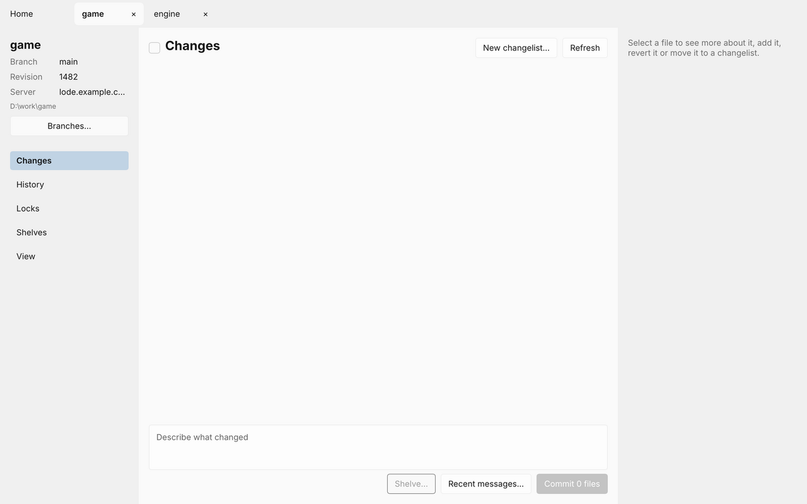

## The daily loop

**Changes** lists what differs from the revision you have: modified (M), added (A), deleted
(D), files not added yet (?), and files in conflict (C). The list follows the disk: save a
file in your editor and it shows up within a moment.

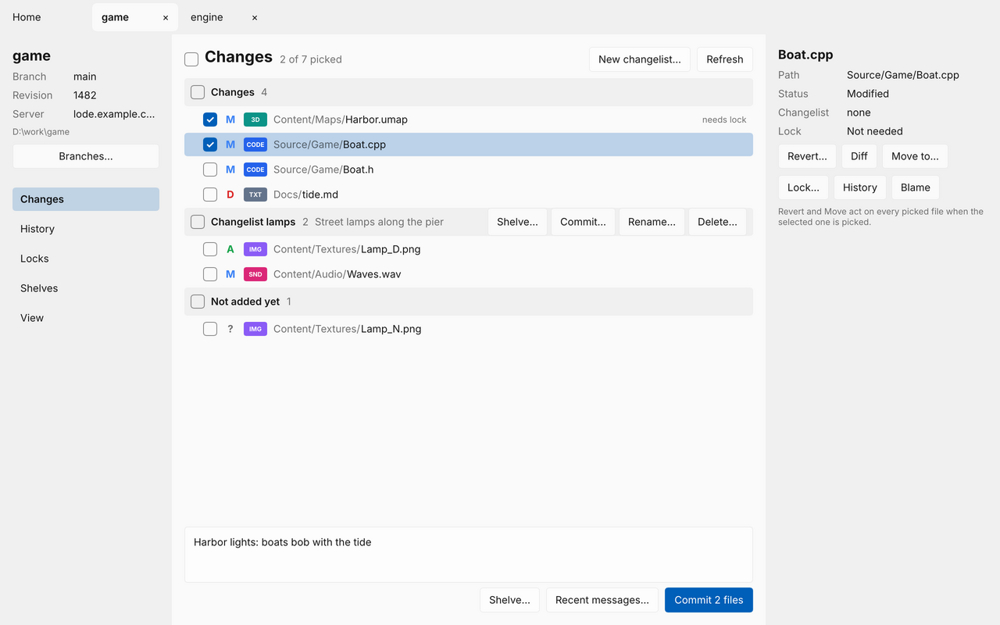

- **Pick** files with their check boxes (or a whole group with the group's box), write a
  message and **Commit**. Only the picked files go in; the rest stay as they are. Files not
  added yet are added when picked.
- Click a file to see its details on the right: **Show diff**, **Revert…**, **Lock…**,
  **History** and **Blame**. Right-click a file for the same actions.
- If someone committed the same file first, the commit is refused and names the files. Update
  (the branch button, then **Update to r…**; see [Branches](#branches-and-merges)) and commit
  again.

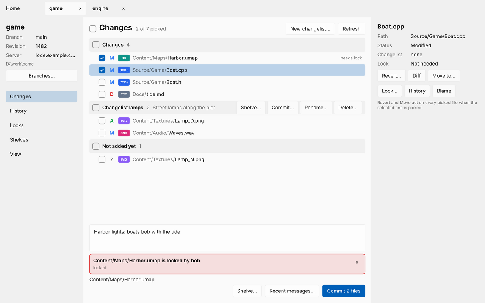

### Check changes

Pick the files you want to check and choose **Check changes**. With no boxes checked, Desk
checks the highlighted file. Add new files to the workspace before checking them. **Commit**
and **Shelve** run the configured scripts on the files in their own operation. While a script
runs, Desk shows its name and file count. **Cancel** stops the script and keeps your edits.

When Desk first asks to run depot scripts, select a script and choose **Show script** to
inspect its contents. **Run** trusts the current script versions for this depot.
**Don’t run** stops the operation. If Python is missing or too old, the banner’s **Python help**
opens the [interpreter setup guide](../../docs/agent-validation.md#trust-the-scripts-and-select-python).
Dismiss the banner to hide it for this session.

Each script has a result. Click a
diagnostic to select its file and scroll to the reported line when it appears in the diff.
**Check broke** includes the script’s captured output. After saving edits, choose
**Fix and check again** to recheck the same files without sending them.

**Shelve anyway** skips local checks for this attempt. A server with validation enabled
checks the new shelf version, and a gated branch requires passing checks before submission.
**Commit anyway** uses the current commit message and is only available for a direct commit
on a branch that allows it. When the branch requires a shelf, **Shelve instead** runs the
normal shelf checks and keeps the local edits.

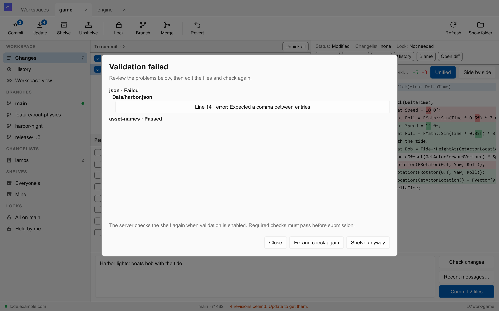

[View the same results in the dark theme](guide/validation-dark.png).

### Locks

Files that cannot be merged, such as art and maps, are marked **needs lock**. Lock one before
you change it: **Lock…** on the file, with a comment others will see. **Locks** in the sidebar
lists every lock on the branch, yours first, with Unlock for yours. A commit releases the locks of the files it
commits.

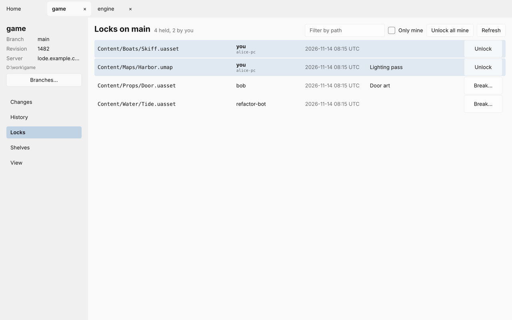

When someone else holds the lock, the lock is refused and says who. Only a depot admin can
break another person's lock.

### Changelists

**New changelist…** groups changes you want to commit separately, such as a fix you are not
ready to send. Right-click files and choose a changelist under **Move to**. A changelist has
its own **Commit…**, which uses its description as the message, plus **Shelve…** and
**Delete…** (deleting a changelist sends its files back to Changes; no change is lost).

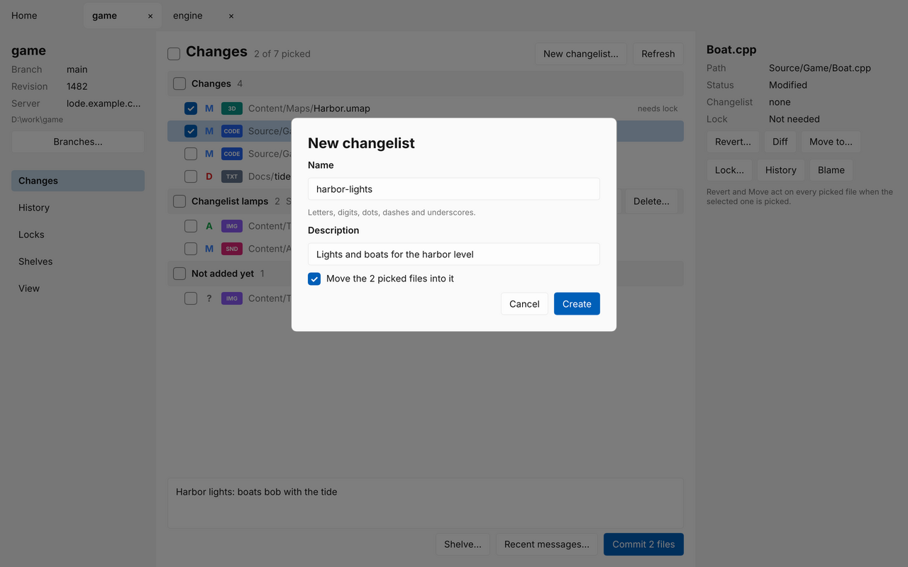

## History, blame and diffs

**History** shows the branch's revisions, newest first, with a graph of merges, a badge with
the checks of each revision (passed, failed or still running) and badges for agents and
imports. Scroll for older
ones; they load as you go. Click a revision for its message, author, checks and changed files.
**Copy link** copies a link to the revision, and **Link** beside a file copies a link to that
file at that revision.

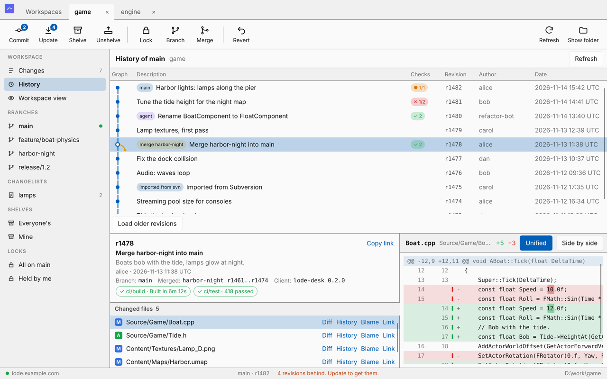

**History** on a file shows only the revisions that changed it, following renames.

**Blame** shows, for each line, the revision that last changed it. Click a revision number to
open that revision.

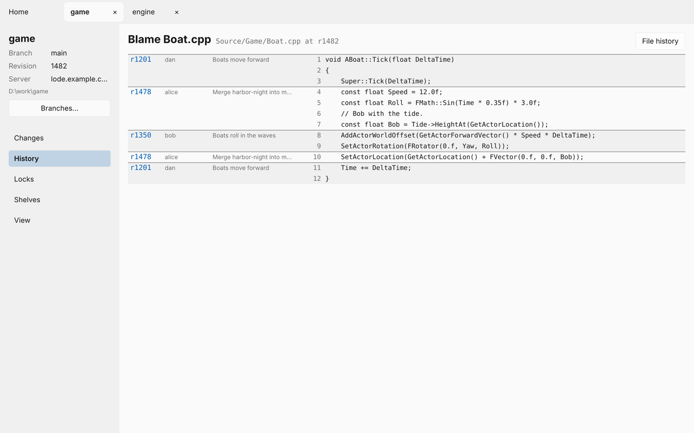

**Show diff** compares your file with the revision you have, or a file in a revision with the
one before. Switch between unified and side by side; the choice is remembered.

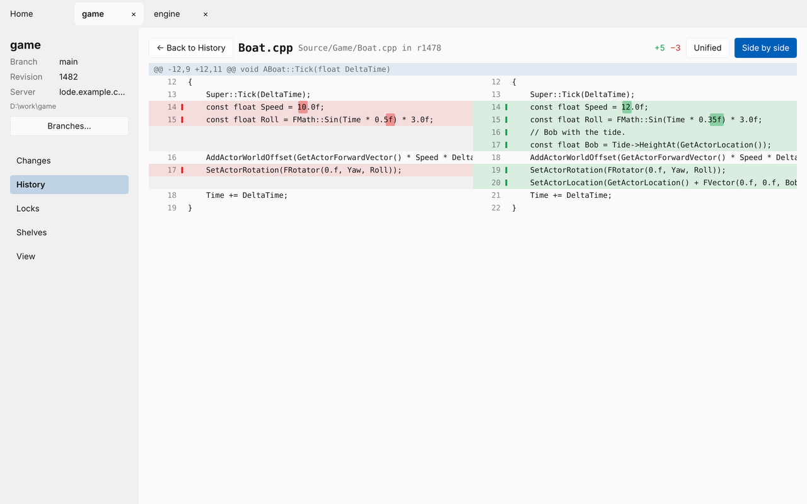

Images are shown side by side, as a swipe or as an onion skin.

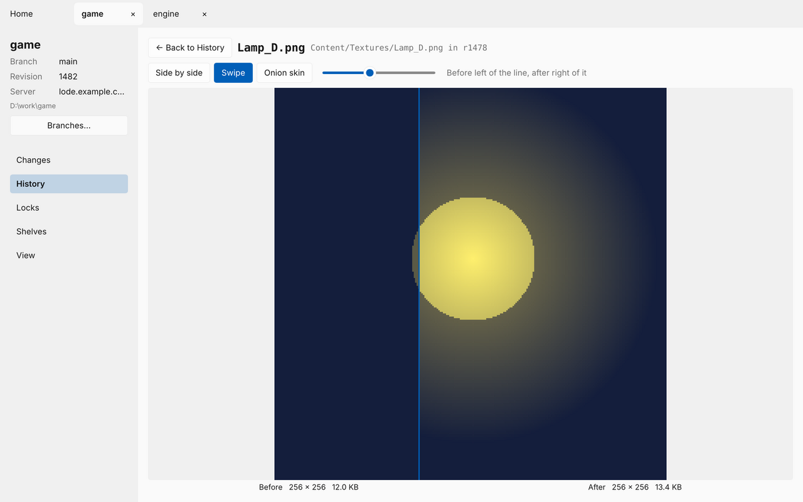

## Shelves and review

A shelf keeps changes on the server without committing them: to ask for a review, to move
work to another computer, or to put something aside. Pick files in Changes and choose
**Shelve…**. By default the shelved files are reverted here; tick **Keep my changes in the
workspace** to keep them.

**Shelves** lists open, submitted and deleted shelves, yours or everyone's. A shelf shows its
description, files, diff and checks.

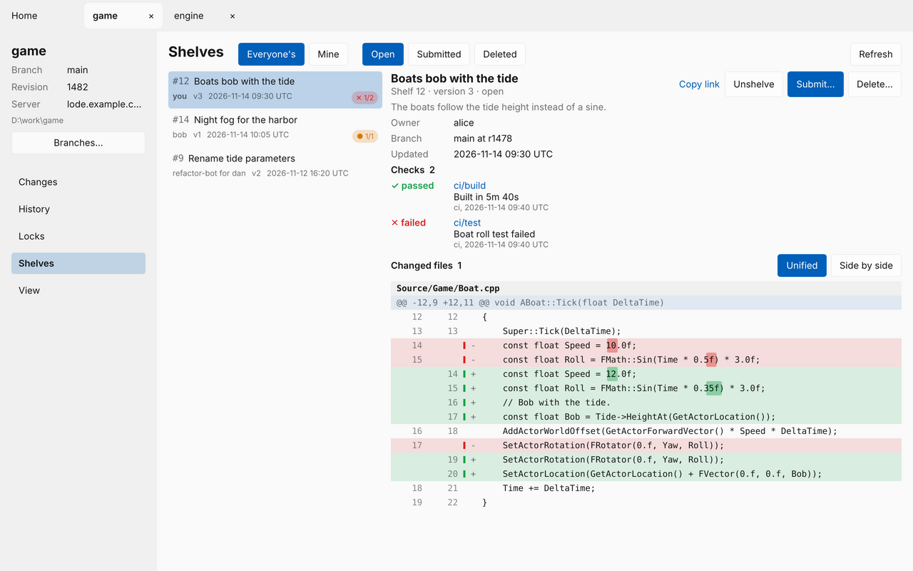

- **Unshelve** brings a shelf's changes into your workspace, to try them or to continue them.
- **Submit…** commits the shelf as it is. If the owner updated it after you looked, the submit
  is refused so that you review what changed first.
- When the depot requires checks, a shelf whose checks have not passed cannot be submitted;
  the refusal lists the checks still missing.
- **Delete…** removes your own shelf. **Copy link** copies a link to it, for a review request.

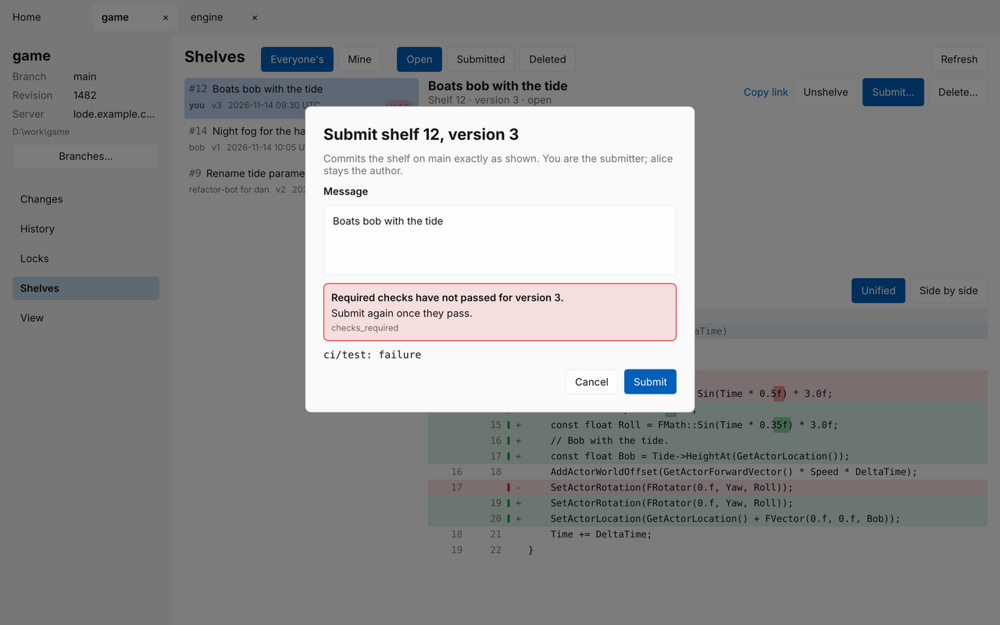

## Branches and merges

**Branches…** in the sidebar opens the branch list: every branch with its head and
where it started. From there:

- With your own branch selected, **Update to r…** brings the workspace to the head of its
  branch. Do this before you start, and when a commit is refused as out of date.
- With another branch selected, **Switch** moves the workspace to it (to its head, or to the
  revision you type). Your local changes come along; files are only fetched where they differ.
  Locks you hold stay on the old branch, and the summary lists them.
- **New branch…** starts a branch from your revision, or from any branch at any revision
  (`release-1.2@r1400`), and can switch to it.
- **Merge…** merges the selected branch into yours.
- **Archive…** hides a finished branch (depot admins only); **Show archived** lists them.

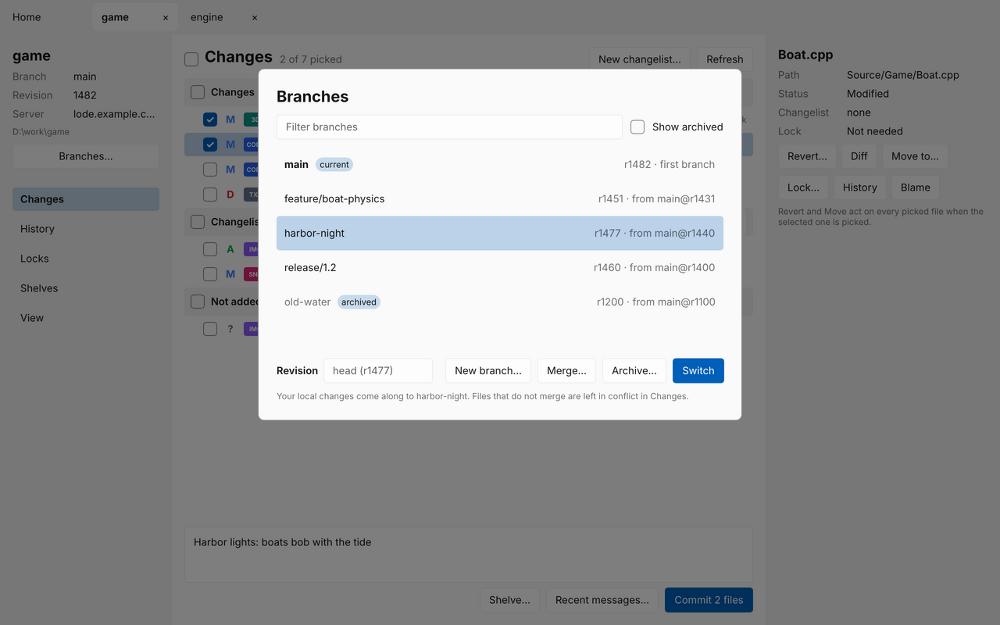

After a switch or update, a summary says what came and what stayed. If it stopped half way,
for example because the connection dropped, an error offers **Finish the update**.

A merge applies the other branch's changes to your files and tells you what happened to each:
applied, merged, conflicted or unchanged. Changes then shows the merge in progress. **Commit
merge** commits everything together; **Abandon merge…** forgets the merge and keeps the files.

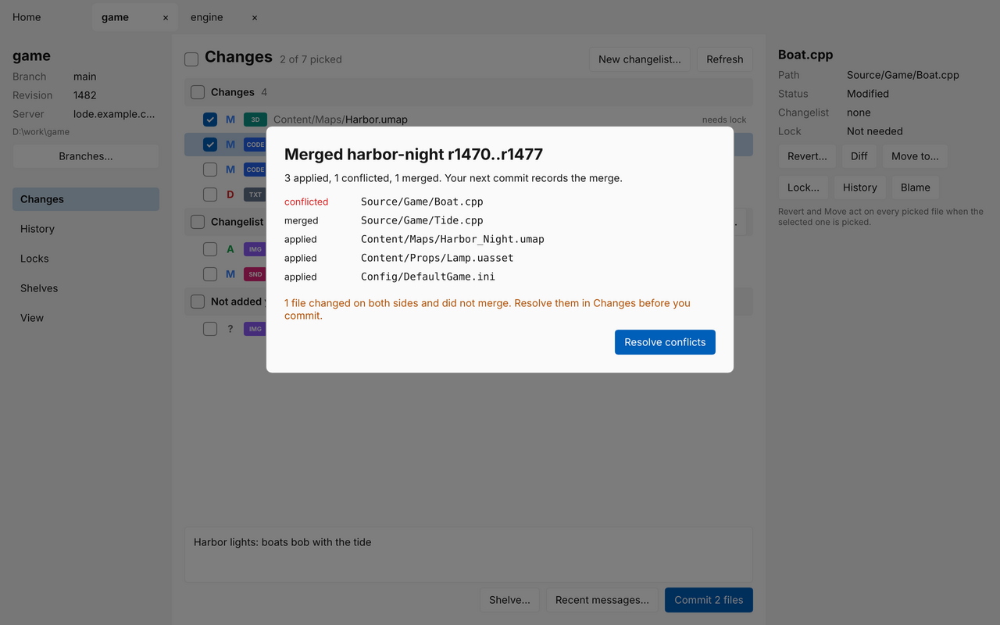

When the depot uses streams, Branches lists them as a tree, each stream under its parent with
its type (mainline, development, release), and ordinary branches after them. **New branch**
has a **Type** picker. A merge the stream rules refuse, such as a copy up from a development
stream that is behind its parent, stops before any file changes and says what to merge first.

## Conflicts

A file changed on both sides that did not merge is in conflict (C). Commit stays off until no
conflict is left. **Resolve…** on the file opens the three-way view: the base, yours and
theirs above, and the result below. Each conflict has **Use mine**, **Use theirs** and **Use
both**, and the result can also be edited by hand; **Take mine** and **Take theirs** settle the
whole file at once. **Save and mark resolved** saves the result once no conflict is left.

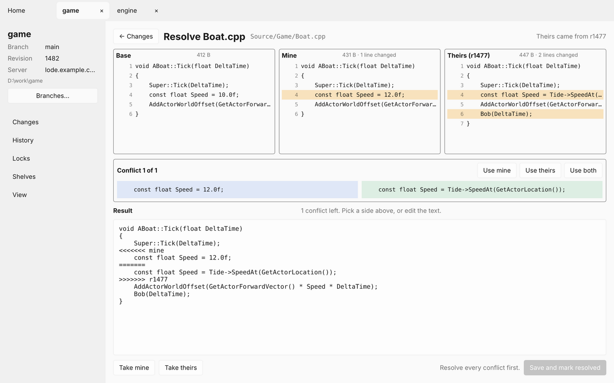

For a file that is not text, such as an image, choose **Keep mine** or **Take theirs**. Theirs
is also saved beside the file (`name.theirs-r<rev>`) so you can open it in its own tool first.

When the depot names a merge tool for the file and your `settings.toml` says what it runs,
the conflict view has **Open in <tool>**. Lode Desk starts the tool with the base, yours,
theirs and a result file, and marks the file resolved when the tool succeeds. See "Merge
tools" in the user guide for the settings.

## The workspace view

A depot can be larger than you need. **View** in the sidebar says how much of the depot
is in your view and on disk, and lets you choose which folders come to disk: tick a folder to
bring it, untick it to leave it out. The ticks become include and exclude patterns, which you
can also edit as text (`*` stays within a folder, `**` goes into subfolders; excludes win).

**Preview change** says how many files would be fetched and removed before anything happens;
**Apply** does it, and you can keep working while it runs. A file with local changes that would
leave the view stops the change; commit, shelve or revert it, or drop the changes with a
second confirmation.

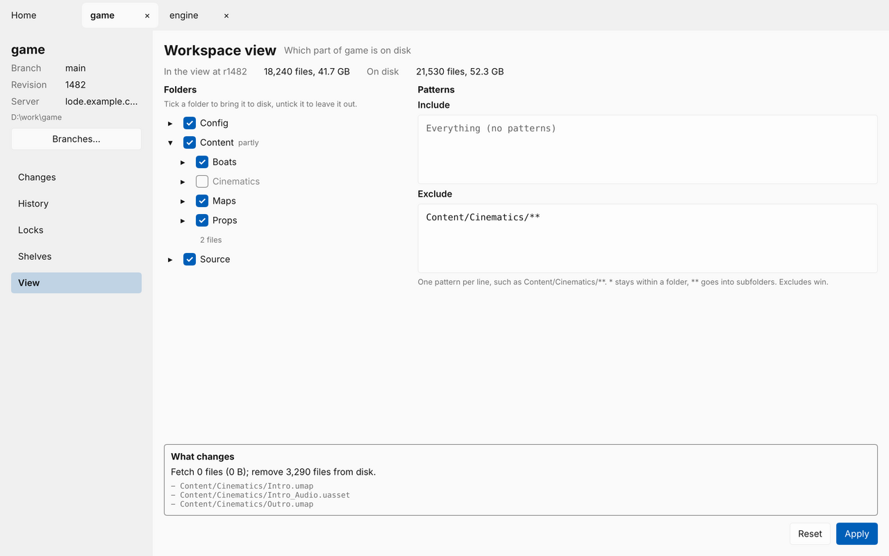

## Links

**Copy link** on a revision, on a file in a revision, and on a shelf copies a `lode://` link
you can paste into chat, a ticket or a review:

```
lode://lode.example.com/game/r1482
lode://lode.example.com/game/Source/Game/Boat.cpp@1477
lode://lode.example.com/game/shelf/44
```

Clicking one opens it in Lode Desk (starting the app if needed; when it already runs, the
running window takes the link, so there is never a second one). On macOS the app starts or
comes forward but does not open the link's target yet. The app picks a workspace of
the same server and depot from your open tabs and Home's list. When several fit, it asks which
one; when none does, it offers to check the depot out and then shows the link. A link that
arrives while a dialog is open waits until you close it.

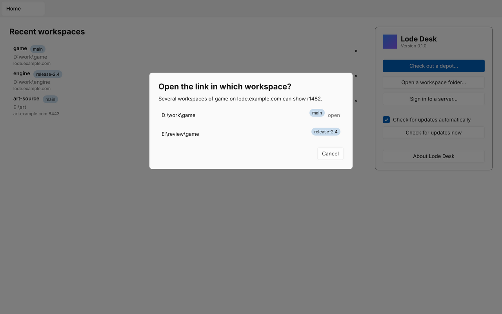

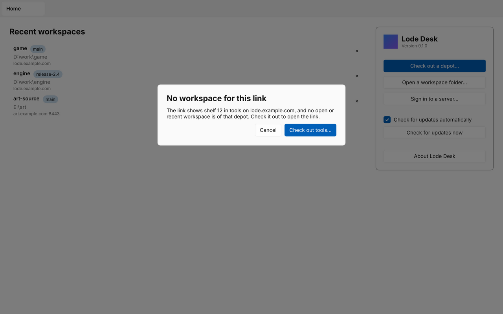

A link that is not exactly one of these forms is refused with the reason, and nothing is
opened. Links never carry user names or passwords.

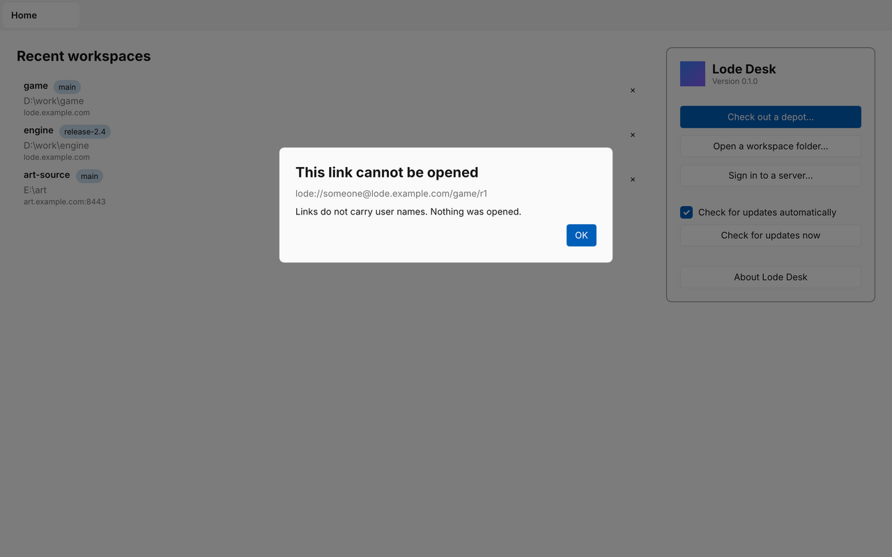

## Updates

The app looks for a new version shortly after it starts and once a day. When there is one, a bar at the
top shows it, with **What's new**, **Install and restart** and **Later**. An update is
installed only when it is signed with the project's key; anything else is refused. Install and
restart runs the MSI or setup program (Windows asks for permission for the MSI), replaces the
AppImage or the app in Applications, or installs the `.deb` after asking for your password, and
then starts the new version.

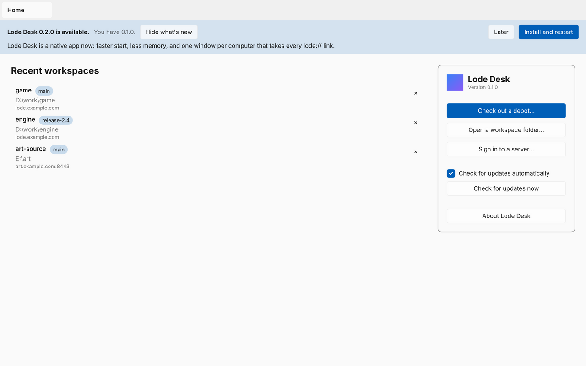

Home has **Check for updates automatically** and **Check for updates now**. On machines whose
software is managed, setting the environment variable `LODE_DESK_NO_UPDATE` (to anything)
turns every check off.

## What errors mean

Errors show the message, a next step where one helps, and a code. The codes:

| Code | What happened | What to do |
| --- | --- | --- |
| `unauthenticated` | You are not signed in to that server, or the sign-in expired. | Sign in from Home. |
| `permission_denied` | Your account may not do this here. | Ask a depot admin. |
| `not_found` | The depot, branch, revision, file or shelf does not exist (any more). | Check the name; Refresh. |
| `not_a_workspace` | The folder is not a Lode workspace. | Pick the folder you checked out into. |
| `already_a_workspace` | The checkout folder already holds a workspace. | Open it, or pick an empty folder. |
| `workspace_in_use` | A `lode` command is using the workspace right now. | Try again when it has finished. |
| `checkout_incomplete` | A checkout stopped before it finished. | Check out into the same folder again. |
| `update_incomplete` | An update or switch stopped before it finished. | **Finish the update**. |
| `network` | The server cannot be reached. | Check the address and your connection. |
| `insecure_url` | The address is plain `http://` to another computer. | Use `https://`. |
| `out_of_date` | Someone committed these files first. | Update, then commit again. |
| `locked` | Someone else holds the lock. | Ask them, or a depot admin. |
| `lock_required` | The file must be locked before it is committed. | Lock it, then commit. |
| `conflicted` | Files are still in conflict. | Resolve them first. |
| `conflict` | The shelf changed since you looked, or the name is taken. | Look again, then retry. |
| `checks_required` | The shelf's required checks have not passed. | Wait for them or fix the change. |
| `sso_failed` | The company sign-in was refused or not finished within 5 minutes; the message says why. | Ask a server administrator to add or enable your account if the message names it; otherwise sign in again. |
| `obliterated` | An administrator removed this content from the server for good. | Nothing to fix: the file's other versions still open. An update leaves such files out and lists them. |
| `module_disabled` | The server does not have that feature (locks, shelves, checks). | Ask the server's admin. |
| `usage` | The request itself was wrong, such as a bad branch name. | Read the message. |
| `invalid_path`, `invalid_pattern` | A path or view pattern cannot be used. | Fix it. |
| `bad_signature` | An update was not signed with the project's key, so it was not installed. | Report it; install by hand from the release page. |
| `update_failed` | The update could not be downloaded or installed. | Try later or install by hand. |
| `io` | A file could not be read or written. | Check disk space and permissions. |

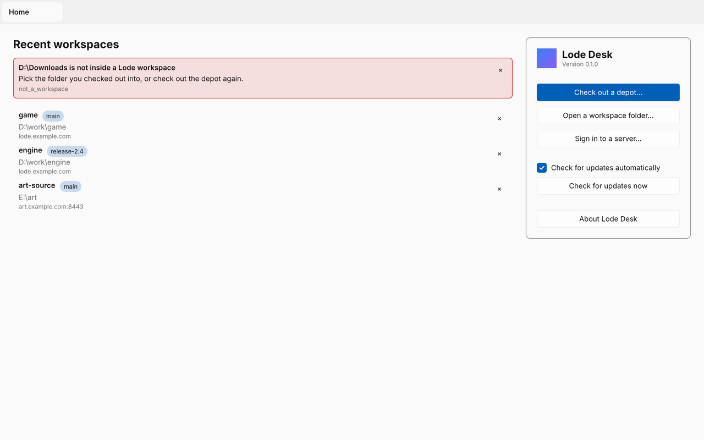

---

How this guide is checked: `desk/tests/acceptance.rs` follows it section by section
against a real server with two people, and [acceptance.md](acceptance.md) is the
checklist for what needs a person.
